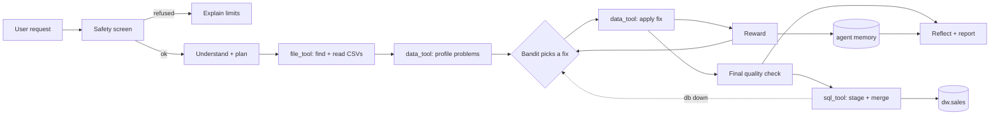
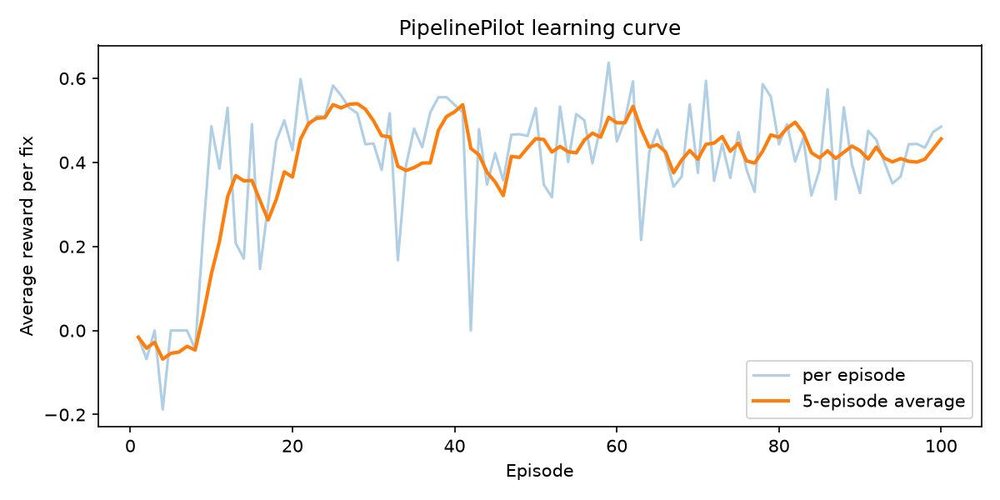

# PipelinePilot: A Self-Correcting Data Pipeline Agent

**ITAI 2376: Deep Learning, Final Project (AI Agent Development)**
**Group:** Rich Fox (solo)
**Student:** Rich Fox ([@rfox7](https://github.com/rfox7))
**Project option:** Option 2, Process Automation Agent

---

## What it does

You give PipelinePilot a plain-English request like:

> "Load this week's sales files, check them, and tell me what happened."

The agent:

1. **Screens** the request for anything harmful or out of scope.
2. **Plans** the job: find the files, read them, check them, fix problems, load, report.
3. **Finds problems** in the data: bad dates, text in number columns, missing keys, duplicate rows, renamed columns.
4. **Picks a fix** for each problem and **learns which fixes work** from the results (reinforcement learning).
5. **Recovers** when the database is unavailable, and learns the best way to retry.
6. **Loads** clean rows into an Azure SQL warehouse and keeps bad rows in a reject table.
7. **Reports** what happened, what it chose and why, and a short lesson-learned note.

## How it lines up with the assignment

| Requirement | Where it lives |
|---|---|
| Input processing | `src/safety/request_screen.py`, `src/agent/reasoning.py` (`parse_request`) |
| Memory system | `src/agent/memory.py` (short-term run memory + long-term tables in the `agent` schema) |
| Reasoning component | `src/agent/reasoning.py` (plan), `src/agent/core.py` (ReAct-style fix loop) |
| Output generation | `src/agent/core.py` (`_finish`): report, reasoning trace, reflection |
| Language-based planning | `src/agent/llm.py` + `reasoning.py`: Claude (or OpenAI) parses the request and writes reflections, with a rule-based fallback |
| Agent patterns | Plan-then-execute + ReAct (thought → action → observation) + reflection |
| Tools (3) | `file_tool` (CSV files), `data_tool` (pandas), `sql_tool` (Azure SQL / SQLite) |
| Tool error handling | `src/tools/base.py` (`safe_tool_call`: every call returns a result, never crashes) |
| Reinforcement learning | `src/agent/bandit.py`: epsilon-greedy bandit with rewards, decay, and user feedback |
| Safety | `src/safety/`: request screening, SQL allow-list, file path limits, plus database permissions |

## Report

- [Project report (PDF, submission version)](PipelinePilot%20-%20ITAI2376%20Final%20Project%20Report.pdf): the condensed 8-page report
- [Project report (full version)](PipelinePilot%20-%20ITAI2376%20Final%20Project%20Report.md): every section in full detail, with figures in `report_images/`

## Documentation

- [Architecture](docs/architecture.md): components, data flow, tools, design decisions
- [How it learns](docs/learning.md): rewards, the bandit, exploration, feedback
- [Safety](docs/safety.md): both safety layers, fallbacks, transparency, known limits
- [The data](docs/data.md): the synthetic sales files, their columns, and the planted problems
- [Results](docs/results.md): learning curve and evaluation numbers

## Architecture



**Database schemas** (same names in Azure SQL and SQLite):

- `staging`: work area the agent controls (`sales_clean`, `sales_reject`)
- `dw`: final table (`sales`). The agent can insert and update but never delete or alter.
- `agent`: the agent's memory (`run_log`, `step_log`, `strategy_scores`)

## How the learning works

Every problem type has a few possible fixes:

| Problem | Fixes the agent can try |
|---|---|
| `missing_column` | `map_aliases`, `skip_file` |
| `bad_date` | `parse_multi_format`, `reject_rows`, `skip_file` |
| `type_mismatch` | `coerce_numeric`, `reject_rows`, `skip_file` |
| `missing_value` | `reject_rows`, `fill_default`, `skip_file` |
| `duplicate_key` | `keep_last`, `keep_first`, `reject_all_dupes` |
| `db_unavailable` | `retry_backoff`, `retry_immediate`, `abort` |

The agent isn't told which fixes are good. Some are traps: `fill_default` makes rows *look* complete but leaves fake keys, and `keep_first` keeps the voided copy of a corrected row. After each fix the agent gets a **reward from -1 to +1**:

- **+** for each affected row that is now truly valid
- **−** for each affected row that is still broken (a fake fix)
- **−** for each good row thrown away (collateral damage)
- **0** for safely rejecting bad rows (safe, but nothing saved)

The **epsilon-greedy bandit** usually picks the best-scoring fix and sometimes tries another one to keep learning. It explores less as it gains experience. Scores are saved in `agent.strategy_scores`, so learning carries over between runs. Thumbs up or down on a run (interactive mode) nudges the scores of every fix used in that run.

`examples/train_bandit.py` runs many practice episodes and saves a learning curve:



## Safety

Two layers, so one mistake can't cause damage:

1. **Python checks:**
   - The request screen refuses destructive requests, credential requests, prompt-injection attempts and system commands, and explains what the agent *can* do.
   - The SQL guard allows one statement at a time, with no comments and no DROP/TRUNCATE/ALTER/EXEC. Writes go only to staging/dw/agent, DELETE works only in staging, and UPDATE outside staging needs a WHERE clause.
   - File access is limited to the incoming data folder, CSV files only, with a size limit.
2. **Database permissions:** the agent logs in as `agent_user`, which has no permission to drop, alter, or delete outside `staging` (see `sql/01_setup_azure.sql`). Even if a bad statement got past the Python checks, Azure SQL would refuse it.

The agent never loads a row that fails the final quality check. Every reject is kept with its reason.

## Setup

**Requirements:** Python 3.10+. For Azure SQL you also need the Microsoft ODBC Driver 18 for SQL Server.

```bash
py -m pip install -r requirements.txt
copy .env.example .env      # then edit .env
```

### Option A: run locally with SQLite (no accounts needed)

Leave `DB_BACKEND=sqlite` in `.env`. The database files are created in `data/sqlite/` on first run.

### Option B: Azure SQL Database (free tier)

1. Create a free Azure SQL Database (free offer, auto-pause when the free limit is reached).
2. As the admin, run `sql/01_setup_azure.sql`, then `sql/02_create_tables_azure.sql`.
3. In `.env`, set `DB_BACKEND=azure` and fill in the `AZURE_SQL_*` values, using `agent_user`, not the admin.
4. Test the connection: `py test_connection.py`

### Optional: LLM (Claude, OpenAI or Azure OpenAI)

Set `ANTHROPIC_API_KEY` in `.env` to let Claude (default `claude-haiku-5-5`) parse requests and write the reflection notes. `OPENAI_API_KEY` or the `AZURE_OPENAI_*` values work too; `LLM_PROVIDER` picks one. Without a key the agent uses rule-based versions of both and works the same way. The trace shows which was used, e.g. `parsed by LLM (claude-haiku-5-5)`.

Only short summaries are sent to the LLM (the request text, fix names, counts, rewards), never the contents of the data files.

## Usage

```bash
py -m src.simulate --files 3                       # make sample files with planted problems
py main.py "Load the sales files and tell me what happened"
py main.py "Just check the sales files, don't load them"   # dry run
py main.py "What's the status of the last runs?"
py main.py                                          # interactive mode with thumbs up/down

py examples/train_bandit.py --episodes 60 --fresh  # learning curve (use SQLite)
py examples/run_demo.py                             # the 5 demo video scenes
py -m pytest                                        # tests
```

## Project layout

```
main.py                  command-line entry point
src/
  config.py              settings from .env
  db.py                  Azure SQL / SQLite connection layer
  simulate.py            makes practice files with planted problems
  agent/
    core.py              main loop: screen, plan, execute, recover, reflect, report
    reasoning.py         request parsing, planning, reflection (LLM optional)
    memory.py            short-term run memory + long-term history
    bandit.py            epsilon-greedy learner
    llm.py               optional LLM client: Claude, OpenAI or Azure OpenAI
  tools/
    base.py              safe_tool_call wrapper + error types
    file_tool.py         find and read CSVs (incoming folder only)
    data_tool.py         profile problems, apply fixes, score rewards
    sql_tool.py          guarded SQL: stage, reject, merge
  safety/
    request_screen.py    refuse harmful or out-of-scope requests
    sql_guard.py         SQL allow-list
    path_guard.py        file access limits
sql/                     Azure setup + table scripts, SQLite schema
tests/                   pytest suite (runs on SQLite)
examples/                demo scenes + training script
data/incoming/           where the agent looks for CSV files
```
