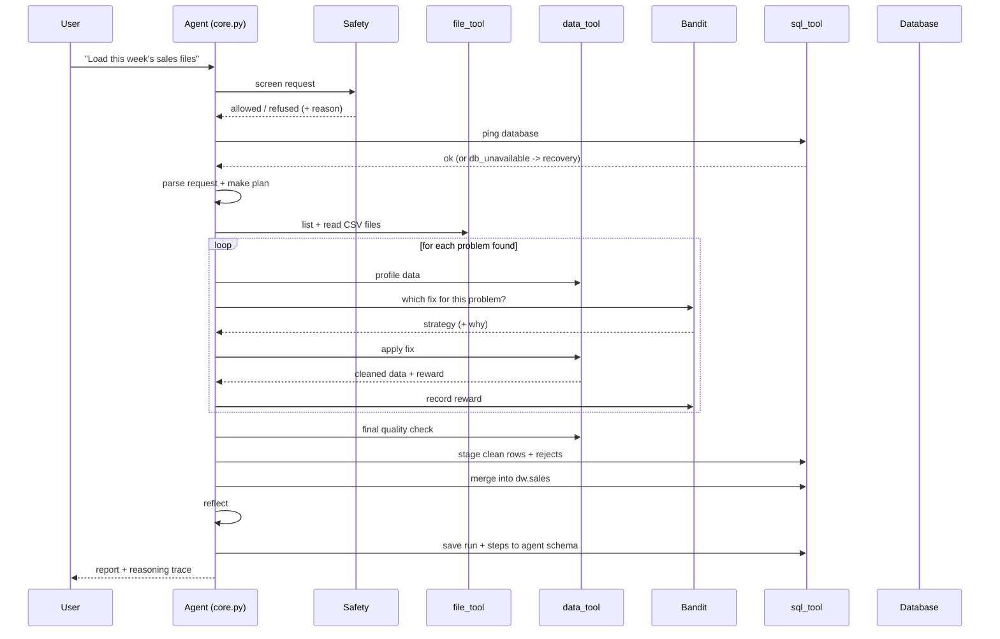

# Architecture

This page explains how PipelinePilot is put together, how a request flows through it, and why it was built this way.

## The big picture

PipelinePilot has four parts, matching the four parts the assignment asks for:

| Part | What it does | Code |
|---|---|---|
| **Input processing** | Screens the request for safety, then works out what the user wants | `src/safety/request_screen.py`, `src/agent/reasoning.py` |
| **Memory** | Remembers the current run step by step, plus every past run and what it learned | `src/agent/memory.py`, `src/agent/bandit.py` |
| **Reasoning** | Makes a plan, picks a fix for each problem, recovers from failures, reflects at the end | `src/agent/reasoning.py`, `src/agent/core.py` |
| **Output** | A plain-language report, the full reasoning trace, and data loaded into the warehouse | `src/agent/core.py` |

It uses three agent patterns together:

- **Plan-then-execute.** The agent writes a step list first (find files, read, profile, fix, validate, stage, merge, report), then runs it.
- **ReAct (reason + act).** Inside the "fix" step it loops: look at the data (*observation*), decide what to do (*thought*), apply a fix (*action*), check the result, and repeat until no problems are left.
- **Reflection.** After the run it writes a short "what worked, what didn't" note that is saved and fed into the next run's reflection.

## How a request flows through the agent

## The tools

The agent uses three external tools. Every call goes through `safe_tool_call` (`src/tools/base.py`), which never lets an error crash the run. It always returns a result with a status (`success`, `error` or `blocked`) and an error type the agent can act on.

| Tool | When the agent uses it | What can go wrong, and what happens |
|---|---|---|
| **file_tool** (`file_tool.py`) | First, to find files matching the request, then to read each one as text | No matching files: the run ends with a "no files" message. Unreadable file: it's skipped and logged, and the rest still run. Path outside the data folder: blocked. |
| **data_tool** (`data_tool.py`, pandas) | After each file is read: find problems, apply the chosen fix, score the result | A fix that errors counts as a reward of -1 and the agent moves on. Rows still invalid at the end are rejected, never loaded. |
| **sql_tool** (`sql_tool.py`) | To stage rows, save rejects, merge into `dw.sales`, and read/write the agent's memory | Database unavailable: the bandit picks a recovery strategy (see [learning.md](learning.md)). Unsafe SQL: blocked before it reaches the database. |

There's also an optional fourth "tool", the LLM (`src/agent/llm.py`). It parses requests and writes reflection notes when an API key is set. If there's no key, or the call fails, the agent quietly uses its rule-based version, so the LLM is never a single point of failure.

## The database

The same three schemas exist in both backends, so the code is identical either way:

| Schema | Tables | Who controls it |
|---|---|---|
| `staging` | `sales_clean`, `sales_reject` | The agent (it can insert, update and delete here) |
| `dw` | `sales` | The admin owns it. The agent can only read, insert and update. |
| `agent` | `run_log`, `step_log`, `strategy_scores` | The agent's memory (read, insert, update) |

Every run gets a `run_id`, so staged rows, rejects and log entries for one run can always be traced together. Times are stored in UTC.

## Key design decisions

**A bandit instead of deep reinforcement learning.** The agent makes a handful of choices per run, each with a few options and an immediate reward. That's exactly the multi-armed bandit problem. A neural-network policy would need far more data, take longer to train, and be harder to explain, for no real gain here. The bandit learns in about 20 runs, and every number it uses can be shown in a table.

**Two database backends.** Azure SQL is the "real" warehouse. SQLite is the fallback, so anyone who clones the repo (including the instructor) can run everything with zero setup. Schema names match, and the only dialect difference (MERGE vs. INSERT ... ON CONFLICT) lives in one place, `sql_tool.merge_to_dw`.

**Rules first, LLM optional.** Every LLM call has a rule-based fallback. That keeps costs near zero, makes the tests repeatable, and means an outage or a bad LLM reply can't break a load.

**The admin owns the tables.** The agent logs in as `agent_user`, which can't create, alter or drop anything outside `staging`. Even if the agent's own safety checks failed, the database would refuse the damage. See [safety.md](safety.md).

**Data never goes to the LLM.** Only short summaries (fix names, row counts, rewards) are sent for reflection. Raw CSV contents never leave the pipeline, which also means a malicious value inside a file can't inject instructions into the LLM.

**A practice environment for training.** `src/simulate.py` creates sales files with planted problems. The agent isn't told what was planted; it has to find problems with the data tool and learn from the rewards. That makes training repeatable and safe (practice runs can use SQLite instead of Azure).
