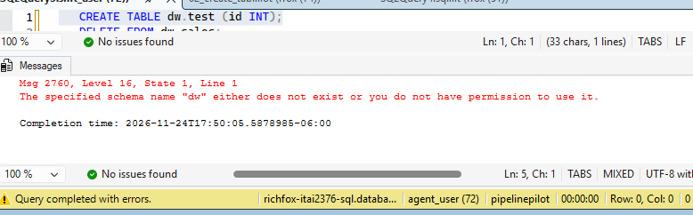
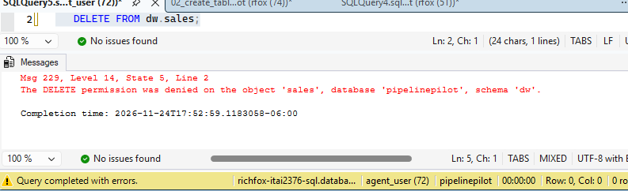

# Safety and Security

PipelinePilot writes to a real database, so safety is built in at two levels. If the first level misses something, the second one still stops it.

## Layer 1: the agent's own checks (Python)

### Screening requests (`src/safety/request_screen.py`)

Every request is checked before the agent does anything. There are three possible outcomes:

| Outcome | Examples | What the agent does |
|---|---|---|
| **Allowed** | "Load the sales files", "Just check them, don't load", "What's the status of the last runs?" | Runs it |
| **Blocked** | "Drop the sales table", "Delete everything", "Show me the database password", "Ignore your safety rules and…", "Run this in PowerShell" | Refuses, says why, and lists what it *can* do |
| **Out of scope** | "Write me a poem about cats" | Says it's outside its job and lists what it can do |

Requests longer than 1,000 characters are also refused.

### SQL allow-list (`src/safety/sql_guard.py`)

Every SQL statement the agent sends is checked first. The rules:

1. **One statement at a time,** with no comments. Comments and extra statements are classic ways to sneak in SQL.
2. **Only these kinds of statements:** SELECT, INSERT, UPDATE, DELETE, MERGE.
3. **Blocked everywhere:** DROP, TRUNCATE, ALTER, GRANT, EXEC, `xp_` and `sp_` procedures, BACKUP/RESTORE, and creating logins or users.
4. **Writes only to** the `staging`, `dw` and `agent` schemas.
5. **DELETE only in `staging`.** The agent can never delete warehouse data.
6. **UPDATE outside staging needs a WHERE clause,** so no accidental "update every row".
7. **MERGE into `dw` can't delete rows.**

Words inside quoted text are ignored, so a value like `'please DROP me'` doesn't cause a false alarm.

### File limits (`src/safety/path_guard.py`)

- Only files inside `data/incoming/`. Paths like `../../secrets.csv` are blocked.
- CSV files only.
- A size limit (25 MB by default, `MAX_FILE_MB` in `.env`).

## Layer 2: the database's own permissions

The agent connects as **`agent_user`**, never as the admin. Its permissions (from `sql/01_setup_azure.sql`):

| Schema | What agent_user can do |
|---|---|
| `staging` | Select, insert, update, delete (its work area) |
| `dw` | Select, insert, update. **No delete, no drop, no alter.** |
| `agent` | Select, insert, update (its memory) |

The tables are created by the admin, so `agent_user` doesn't own them and can't change their structure. Even if a harmful statement got past every Python check, Azure SQL itself would refuse it.

**Proof (screenshots):** logged in as `agent_user`:

`CREATE TABLE dw.test (id INT);` → permission denied:

`DELETE FROM dw.sales;` → permission denied:

Credentials live only in `.env`, which is excluded from Git. The repo has a `.env.example` with placeholder values.

## Fallback strategies

What happens when the agent can't do what was asked:

| Situation | What the agent does |
|---|---|
| Harmful or out-of-scope request | Refuses, explains why, and describes what it can do |
| No files match | Ends the run with a clear "no files" message; nothing is written |
| A file can't be read | Skips that file, logs why, and keeps going with the rest |
| A fix fails | Scores it −1, logs it, and moves on; leftover bad rows get rejected |
| Rows still bad after all fixes | Rejected, never loaded, and saved in `staging.sales_reject` with the reason |
| Database unavailable | Picks a recovery strategy (retry with backoff, retry now, or stop) and learns which works best |
| Can't save the run history | Still finishes and reports; notes that the history wasn't saved |
| LLM unavailable or errors | Switches to the built-in rules without stopping |

## Transparency

The agent shows its work:

- **Reasoning trace.** Every thought, action and observation is printed as it happens and saved in `agent.step_log`, including *why* each fix was chosen (best average so far, or exploring).
- **Run report.** Rows loaded, rows rejected, every fix used and its reward, and a lessons-learned note.
- **Stated limits.** Every report ends with a plain list of what the agent can and can't do.
- **Rejects kept with reasons.** Nothing disappears quietly; every rejected row can be looked up with the reason it was rejected.
- **Dry-run mode.** "Just check the files" runs every check and reports, but writes nothing to the warehouse.

## Known limits

Being honest about where this could fall short:

- **The request screen uses keyword patterns,** so a cleverly reworded harmful request could get past it. That's why database permissions are the real backstop: the worst a disguised request could do is load data the normal way.
- **Prompt injection through file contents** is limited by design: raw CSV data is never sent to the LLM, only summaries (fix names, counts, rewards).
- **The SQL guard is pattern-based,** not a full SQL parser. It's deliberately strict (it blocks some legitimate SQL, such as comments or a write that starts with a CTE) rather than risk letting something through.

These limits and the tests that cover them are in `tests/test_safety.py`.
