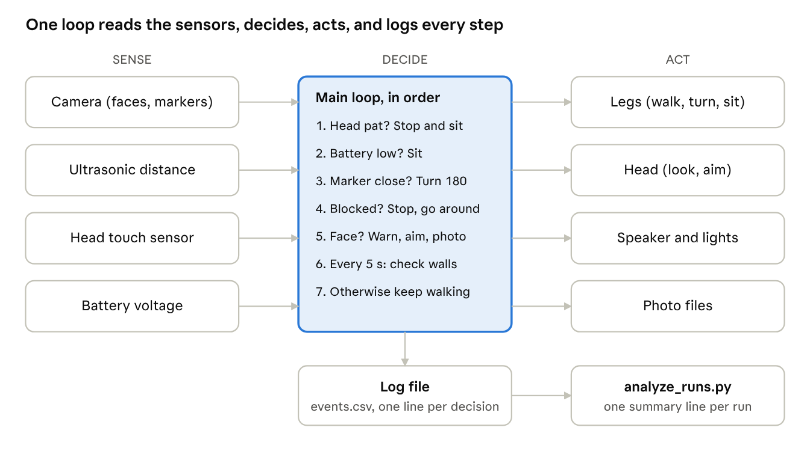

# PiDog Hallway Patrol: Technical Report

Nov 24, 2026

## Summary

We built a hallway patrol for a SunFounder PiDog V2 robot dog. It walks down a school hallway from the C145 classroom, turns around at a paper marker on the far wall, walks back, and stops at a second marker at home. On the way it tries to stay in the middle of the hallway, stops or steers around obstacles, warns people and takes their picture, and records every decision in a log file.

We logged 30 test runs over two days (November 16 and 18, 2026). The dog reached the far marker in 7 runs and completed the full round trip in 2. Raising the stop distance from 30 cm to 48 cm made the dog stop safely before obstacles: on the final version it stopped at a typical 43 cm, compared to 17 cm before, when it often ran almost into things.

**Team 5:** Rich Fox, Sergio Sanchez, Brandon Matias

## Problem statement and goals

A small legged robot has to move through a real school hallway on its own: no map, no GPS, a floor that makes its feet slip, and people and backpacks in the way. The PiDog has no wheel encoders, so it can't count how far it has gone. It has a camera, a forward-facing ultrasonic distance sensor in its head, a touch sensor, and a speaker.

Our goals were for the dog to:

1. Walk from C145 to the end of the hallway and back without help.

2. Stay near the middle of the hallway instead of drifting into a wall.

3. Stop before it runs into anything, and get around obstacles when it can.

4. Notice people, warn them, and take their picture.

5. Stop instantly when someone pats its head.

6. Log what it did, so we could measure how well it worked.

## System design

**Hardware.** Everything runs on the PiDog V2 itself:

| Part                                   | What we used it for                                                    |
|----------------------------------------|------------------------------------------------------------------------|
| Raspberry Pi with SunFounder Robot HAT | Runs the program; powers the servos, speaker and lights                |
| 12 servos (legs, head, tail)           | Walking, turning, sitting; head turns for wall checks and photo aiming |
| Camera in the head                     | Reading markers, finding faces, taking photos                          |
| Ultrasonic sensor in the head          | Distance ahead, and to each wall when the head turns                   |
| Touch sensor on the head               | Emergency stop                                                         |
| Speaker and light strip                | Bark, spoken warning, flash before photos, status colors               |
| Battery                                | Power; voltage is checked so the dog can sit before it runs flat       |
| 2 printed ArUco markers                | Turnaround point at the far wall, and home                             |

**Software.** One Python program, `pidog_patrol.py`, built on SunFounder's `pidog` and `vilib` libraries and OpenCV. It runs one loop that reads the sensors, decides what to do in a fixed order of priority, and acts. Safety checks always come first.

*Software design: sense, decide, act, log*

Because the checks run in this order, a head pat or low battery always wins over everything else, and the dog never looks for a photo while it's about to bump into something. \[Check that this order matches your team's final code.\]

## Methods

**Navigation with markers.** We print two ArUco markers, square black-and-white codes that OpenCV can read in a camera image. Marker 1 is taped on the wall at the far end of the hallway; marker 0 (HOME) stands on a small cardboard tent behind the start spot. The dog walks forward until the next marker it expects looks big enough in the camera, then turns 180° with 8 turning steps. Using the marker's width in pixels is a simple way to judge distance without a map. Over testing we lowered the trigger width from 90 pixels to 18 and switched to a 5×5 marker set, so the dog could see and react to the marker from farther away.

**Staying in the middle of the hallway.** Every few seconds the dog turns its head about 75° left and right and takes three ultrasonic readings on each side (we use the middle value to ignore bad readings). If one wall is more than 15 cm closer than the other, it takes one small turn away from it. If either side reads more than 250 cm, it assumes it's passing an open door or side hall and skips that check.

**Stopping for obstacles and people.** The dog stops walking when the sensor reads less than the stop distance (48 cm in the final version) or the camera sees a face, and it waits until the way stays clear. People hear a spoken warning: "Please clear the path, patrol coming through." *\[confirm wording and when it plays\]*

**Going around obstacles.** If something stays in the way, the dog looks left and right, picks the more open side, steps out to that side, walks past, and steps back in. The log records how many steps it took out, past, and back. Two other recovery behaviors appear in the log: **corner escape**, used when both sides are close (about 50–60 cm), and **stall recovery**, used when the dog doesn't seem to be making progress. *\[describe exactly how your team's versions of these work\]*

**Photos.** When it sees a face, the dog stops, flashes its lights white, and barks once. It then nudges its head until the face is in the middle of the picture, and saves the full photo plus a close-up of the face. It waits 15 seconds before taking another photo, so it doesn't photograph the same person over and over.

**Safety.** Patting the head stops the dog and makes it sit, at any point. It also stops and sits if the battery drops below 6.6 V, or after 45 minutes. A team member walked beside the dog on every run.

**Logging.** Every decision is written as one line to a CSV file: when it happened, which run, what happened, and the details (wall distances, marker size, stop distance and so on). A separate script, `analyze_runs.py`, turns the log into one summary line per run.

## Testing and results

We tested in the hallway outside C145 and logged 30 runs: 11 on November 16 and 19 on November 18. Twenty of them lasted 30 seconds or more; the rest were short checks after a settings change. We tested in three stages, changing the program between each:

| Stage                     | Runs | What changed                                                                                                                        |
|---------------------------|------|-------------------------------------------------------------------------------------------------------------------------------------|
| A: Nov 16, stop-and-go    | 2    | First out-and-back version: walk 2 steps, stop, check sensors, repeat                                                               |
| B: Nov 16, smooth walking | 9    | Keeps walking while checking sensors; aims the camera at faces                                                                      |
| C: Nov 18, team version   | 19   | Stop distance raised to 48 cm; goes around obstacles; corner escape, stall recovery, spoken warning; markers seen from farther away |

**Getting to the end and back.** The dog reached the far marker in 7 runs and completed the full round trip in 2 (117 and 140 seconds). In stage C, 5 of the 15 runs longer than 30 seconds reached the far marker. The 180° turn took 11.6 seconds on average (7 turns, from 7.2 to 15.6 seconds).

**Stopping before obstacles.** This is the clearest improvement in the data:

|                                           | Stage B  | Stage C |
|-------------------------------------------|----------|---------|
| Stop distance setting                     | 30 cm    | 48 cm   |
| Obstacle stops                            | 30       | 24      |
| Typical (median) distance when it stopped | 16.9 cm  | 43.2 cm |
| Stops closer than 20 cm                   | 21 of 30 | 2 of 24 |

In stage B the dog kept moving for a moment after it decided to stop, because steps were already lined up, so it usually ended up much closer than 30 cm and once 0.2 cm away. Raising the stop distance gave it room to stop safely.

**Going around obstacles.** The dog tried to go around an obstacle 17 times. In 12 of the 15 tries on November 18, the sensor showed at least 48 cm of clear space ahead afterward, meaning the way forward was open.

**Staying centered.** The dog checked the walls 317 times. In 58% of checks one side read farther than 250 cm (an open door or side hall), so it skipped the correction. When both walls were in range, the dog was typically 7–12 cm off the middle and at most 90 cm. It steered back toward the middle in about a quarter of checks. Stage C numbers are higher partly because the walls measured farther apart in those runs (about 221 cm wall to wall, compared to 148–178 cm), which gives the dog more room to drift.

**Photos.** The dog took 24 photos. Only 3 have a face close-up, meaning the aiming step found a face in only 3. The camera's face trigger and the aiming step's face finder disagree often; see Limitations.

**Safety stops.** Four runs were ended with a head pat. The low-battery stop worked once, at 6.22 V. Starting battery ranged from 7.0 to 8.6 V.

**Log problems.** Only 7 of the 30 runs wrote an end record. The others most likely ended by unplugging or a crash. One section of the log file was filled with empty bytes, which happens when power is cut while the file is being written. We cleaned these out before analyzing.

## Design changes and lessons learned

- **Start simple.** We first planned a full loop around a block of 8 classrooms with four 90° turns. Testing showed the dog drifted too much, so we cut it to an out-and-back route with two 180° turns. Even the simpler route was hard: only 2 runs made the full trip.

- **The robot drifts, so it needs feedback.** The dog kept wandering to one side and stopping at the wall. Measuring both walls and steering back toward the middle fixed most of that.

- **Stop-and-go walking is slow and jerky.** The first version walked 2 steps and then stopped to check sensors. Keeping steps lined up while checking made walking smooth, but the dog then needed more room to stop (see the stop-distance results).

- **A low camera misses faces.** The camera sits low and looks up at people, so early photos caught bodies but cut off faces. Aiming the head at the face before taking the photo helped, when the face finder works.

- **Simple is better than fancy.** We tried moving the project to ROS 2, first in Docker. Setting that up on the dog would have taken a lot of time and could have broken the shared SD card the whole team uses, so we went back to one plain Python program.

- **Tune in the real place.** Turn steps, marker size and stop distance all had to be adjusted on the actual hallway floor. The log file made it easy to see what each change did.

## Limitations and future work

| Limitation                      | What we saw                                                                      | What we'd try next                                                                                                                  |
|---------------------------------|----------------------------------------------------------------------------------|-------------------------------------------------------------------------------------------------------------------------------------|
| Low success rate                | 2 full round trips; far marker reached in 7 runs                                 | More test runs with settings fixed, so results can be compared fairly                                                               |
| One distance sensor             | 58% of wall checks skipped because of open doors and side halls                  | Follow just one wall when the other is out of range, or add side sensors                                                            |
| Two face finders disagree       | Photo triggered 24 times, face found for aiming only 3 times                     | Use one face detector for both deciding and aiming                                                                                  |
| Only sees faces                 | People walking away aren't seen until they're inside the stop distance           | Add a person-shape (body) detector                                                                                                  |
| Runs don't always log an ending | 23 of 30 runs have no end record; one part of the log was damaged by a power cut | Save the log after every line and log runs that crash                                                                               |
| Not built on ROS 2              | The course checklist asks for ROS 2 topics and services                          | Split the program into ROS 2 nodes (sensors, vision, decisions, logging) once ROS 2 can be installed without risk to the shared dog |

## Ethics reflection

1. **How did the robot make decisions responsibly?** It stops before it moves closer than 48 cm, waits for people instead of pushing past, warns them out loud, and stops the moment someone pats its head. A person walked with it on every run.

2. **Were there safety or privacy concerns?** It photographs people in a shared hallway without asking first. The bark and white flash warn people before each photo. One major concern is that we babysat our PiDog in the hallways so that no one accidentally tripped over the dog running around. Also, the dog is taking pictures of people from the ground. We made a conscious effort to make sure that we only photographed people who were in our class (no minors), and stopped the program if any women were in the video area wearing a skirt or dress.

3. **How could the design be more accessible or inclusive?** First off, this project is great for an academic project, but using a PiDog for surveillance like this is not really practical for real-life. The face detector only works when someone faces the camera, and if people are in wheelchairs or walkers, it's probably not going to see the faces correctly. A more practical deployment for a project like this would either be a drone with a mounted camera, or a series of cameras mounted on servos to "look around". If we were to stick with the PiDog, we would need to run more tests with different sized people and people with disabilities, to test it better.

4. **What did you learn about teamwork and trust in AI?** This project was difficult working as a team. We each had our parts to do, but a lot of the time one member would do their part, but then was stuck watching the next member do their part. For example, I would update the python script, send it to Sergio where he would update the bot and kick off the next testing cycle.

   AI was very helpful, but never got 100% accurate or complete. Almost every process needed to be finetuned. We made it a point to have many parameters in the program so that we could adjust the operations to overcome this.

## References and AI use

- SunFounder. *PiDog documentation.* https://docs.sunfounder.com/projects/pidog/en/latest/

- OpenCV. *Detection of ArUco markers.* https://docs.opencv.org/4.x/d5/dae/tutorial_aruco_detection.html

- OpenCV. *Cascade classifier (face detection).* https://docs.opencv.org/4.x/db/d28/tutorial_cascade_classifier.html

- Code repository: *\[add GitHub link\]*

**AI use:** Parts of the code and the first draft of this report were written with help from an AI assistant (Claude). The team tested, tuned and changed the code on the robot, ran all tests, and wrote the ethics reflection.
